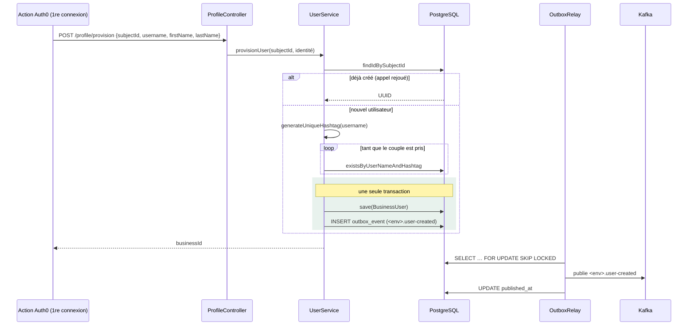

# wely-users

> **Les topics portent leur environnement en préfixe** (`dev.`, `prod.`) depuis le 2026-10-24 :
> un seul broker sert tous les environnements, et le préfixe est la seule chose qui les sépare.
> Côté service, une seule variable le porte — `TOPIC_PREFIX` — et les destinations s'écrivent
> `${TOPIC_PREFIX}user-created`. Aucune valeur par défaut : un service incapable de nommer ses
> topics refuse de démarrer plutôt que de rejoindre le trafic d'un autre environnement.

Service de gestion des profils utilisateurs et **pont entre l'identité Auth0 et l'identité métier** de la plateforme [Wely Calendar](https://github.com/WelyLabs/wely-platform).

C'est le seul service qui écrit dans PostgreSQL, le seul qui détient un accès à la Management API d'Auth0 (modification de profil, suppression de compte, vérification des orphelins), et le producteur de l'événement `<env>.user-created` dont dépend le graphe social. Cet événement part par un **outbox transactionnel** : il est écrit en base dans la même transaction que l'utilisateur, puis relayé vers Kafka.

---

## Rôle

| | |
|---|---|
| **Port** | 8082 |
| **Préfixe** | `/user-service` (exposé via la gateway sur `/api/v1/user-service/**`) |
| **Base** | PostgreSQL via R2DBC |
| **Produit** | `<env>.user-created` sur Kafka |
| **Dépend de** | Auth0, dont l'Action post-login l'appelle à la première connexion ; client Management API (`client_credentials`) · `wely-media` pour les photos de profil |

---

## Stack

Java 25 · Spring Boot 4 · WebFlux · Spring Data R2DBC · Spring Cloud Stream (Kafka) · MapStruct · Lombok · OAuth2 Resource Server + Client

---

## Architecture

Architecture hexagonale. Le domaine déclare trois ports ; l'infrastructure fournit trois adaptateurs.

```
                  ┌──────────────────────────────────────┐
  HTTP            │           application/rest           │
  ───────────────▶│   ProfileController                  │
                  └──────────────────┬───────────────────┘
                                     │
                  ┌──────────────────▼───────────────────┐
                  │              domain/                 │
                  │                                      │
                  │   models/   BusinessUser (record)    │
                  │   services/ UserService  (POJO)      │
                  │                                      │
                  │   ports/                             │
                  │     UserRepository ──────────┐       │
                  │     IdentityProvider ────────┼─┐     │
                  │     MediaStore ──────────────┼─┼─┐   │
                  └──────────────────────────────┼─┼─┼───┘
                                                 │ │
                  ┌──────────────────────────────▼─▼─────┐
                  │           infrastructure/            │
                  │                                      │
                  │  persistence/  R2dbcUserRepositoryAdapter (@Transactional)
                  │                → UserR2dbcRepository │
                  │                → R2dbcOutboxEventStoreAdapter
                  │                  → OutboxEventR2dbcRepository
                  │  identity/     IdentityAuthAdapter   │
                  │                → Auth0ManagementApi  │
                  │  media/        MediaApiAdapter → wely-media
                  │  messaging/    OutboxRelay           │
                  │                → KafkaOutboxDispatcher
                  │                → StreamBridge        │
                  └──────────┬─────────┬─────────┬───────┘
                             ▼         ▼         ▼
                       PostgreSQL  Auth0       Kafka
```

Les deux ports sont fournis par l'infrastructure. Le domaine se contente d'enregistrer un utilisateur : prévenir les autres services (`<env>.user-created`) est un **événement d'intégration**, une conséquence du découpage en microservices et non une règle métier. C'est donc l'adaptateur de persistance qui l'écrit, dans la même transaction que l'utilisateur.

`UserService` est un **POJO sans annotation Spring**, instancié par `UsersApplicationConfig` :

```java
@Bean
public UserService userService(UserRepository repository, IdentityProvider identityProvider) {
    return new UserService(repository, identityProvider);
}
```

Il se teste donc sans contexte Spring, avec deux implémentations d'interfaces.

---

## Le cœur du service : créer à la première connexion

Une opération, appelée par l'Action post-login `wely-business-id` d'Auth0 avant qu'un token existe, protégée par `X-Internal-Secret` :

- **`provisionUser`** crée l'utilisateur à sa première connexion, quand son `app_metadata` ne porte pas encore de `businessId`. Auth0 envoie l'identité dans la requête (`subjectId` = `auth0|…`) : pas d'appel à son API de gestion. L'Action range l'identifiant renvoyé dans `app_metadata` et le pose en claim `businessId` ; les connexions suivantes n'appellent plus le cluster.



`provisionUser` est **idempotente** sur le `subjectId` : un appel rejoué renvoie l'utilisateur existant, et de deux appels simultanés, celui qui bute sur la contrainte de la colonne `subject_id` (qui porte le `subjectId`, nom hérité) renvoie l'identifiant du gagnant.

La publication **ne fait pas partie de la requête** : l'Action attend l'identifiant métier, pas un aller-retour vers le broker, et un Kafka indisponible fait grossir une file au lieu de perdre un événement.

### Les utilisateurs orphelins

Si `wely-users` crée l'utilisateur mais que le compte Auth0 disparaît (inscription annulée, compte supprimé depuis la console avant confirmation), il reste un utilisateur sans compte. **`OrphanUserReaper`**, une boucle de fond comme le relais de l'outbox, s'en charge toutes les heures :

- il lit les utilisateurs de plus de 15 min dont le compte n'a jamais été confirmé (`identity_checked_at` nul) ;
- il demande chacun à la Management API d'Auth0, **un par seconde** et 50 par passe (`app.orphan-reaper.pace`, `batch-size`) : le palier gratuit limite le débit de cette API. Un compte trouvé est marqué confirmé, et n'est plus jamais revérifié ; un compte inconnu (404) fait **supprimer** l'utilisateur, avec un `<env>.user-deleted` écrit dans l'outbox dans la même transaction ;
- une panne d'Auth0, ou un **429** de sa limite de débit, n'est pas une preuve d'absence : l'utilisateur reste à vérifier au passage suivant. Seul un 404 fait supprimer.

`wely-social` consomme `<env>.user-deleted` et supprime le nœud. Les amis fictifs de la démo n'ont pas de compte Auth0 : le jeu de données les marque confirmés.

### Le hashtag

Un utilisateur est identifié publiquement par `Pseudo#1234`, à la manière de Discord. Le hashtag est tiré au hasard entre 1000 et 9999 et retiré tant que le couple `(user_name, hashtag)` est déjà pris. L'unicité est **garantie par la base**, pas par le code :

```sql
CONSTRAINT unique_user_identity UNIQUE (user_name, hashtag)
```

Le tirage aléatoire évite la contention d'un compteur séquentiel partagé ; la contrainte SQL reste le dernier rempart en cas de course.

---

## API

Toutes les routes sont préfixées par `/user-service` et exposées via la gateway sur `/api/v1/user-service/**`.

| Méthode | Route | Auth | Description |
|---|---|---|---|
| `GET` | `/profile` | JWT | Profil de l'utilisateur courant (identité lue dans le claim `businessId`), with `birthDate` (`YYYY-MM-DD` or null) and `registrationCompleted` |
| `PUT` | `/profile/registration` | JWT | A pass of the progressive signup completion, and later a birth-date change: any of `{"birthDate": "1995-03-12", "firstName": "Léa", "lastName": "Martin"}`, each optional. A field left out stays as stored; a field sent must be valid. Names are trimmed. `registrationCompleted` becomes true once the profile misses none of the three fields, false otherwise (the web app derives its pending steps from the fields, iOS reads the flag). Writes `USER_MODIFIED` when names are sent and `USER_BIRTHDAY` when the user has a birth date, answers the profile as `GET /profile` does. Idempotent. An empty pass is 400 `USR-VAL-004`; a date not in the past or an age outside 13 to 120 is 400 `USR-VAL-002`; a blank or over-255-character name is 400 `USR-VAL-003` |
| `GET` | `/profile/about` | JWT | Présentation de l'utilisateur courant : bio (160 caractères) et centres d'intérêt (5 au plus, 24 caractères chacun) |
| `PUT` | `/profile/about` | JWT | La remplace ; espaces nettoyés, doublons retirés (« Rando » et « rando »), refus au-delà des limites (`USR-BUS-008`, 400) plutôt que coupure |
| `GET` | `/profile/preferences` | JWT | Préférences de l'utilisateur courant : `{"theme": "LIGHT" \| "DARK" \| "SYSTEM"}`, `SYSTEM` s'il n'a jamais choisi |
| `PUT` | `/profile/preferences` | JWT | Les remplace ; un thème absent (`USR-VAL-001`) ou hors des trois (`USR-REQ-000`) est refusé en 400 |
| `GET` | `/users/{userId}/profile` | JWT | Profil d'un ami (identité, date d'inscription, bio, centres d'intérêt, `birthday: {month, day}` or null, never the year). Amitié vérifiée auprès de `wely-social` avec le jeton de l'appelant : 403 `USR-BUS-009` sinon, 404 `USR-BUS-001` si l'utilisateur est inconnu, 502 `USR-TEC-005` si `wely-social` ne répond pas. Son propre id renvoie son profil sans appel |
| `POST` | `/profile/provision` | `X-Internal-Secret` | **Interne.** Crée l'utilisateur à sa première connexion, depuis l'Action post-login d'Auth0. Idempotent sur le `subjectId` |
| `POST` | `/profile/picture` | JWT | Remplace la photo de l'utilisateur courant (multipart `file`, 5 Mo au plus) et répond une URL signée |
| `POST` | `/avatars` | JWT | URL des photos de 100 utilisateurs au plus, `{ userId: url }` ; les utilisateurs sans photo sont absents |
| `DELETE` | `/profile` | JWT with a recent `authenticatedAt` | Deletes the caller's account: **202**, no body. 403 `USR-BUS-014` while deletion is switched off, 403 `USR-BUS-011` for a demo account, 202 again for an account already deleted, 403 `USR-BUS-010` when the last sign-in is over 5 min old or unknown, 404 for an unknown id. See [Account deletion](#account-deletion) |
| `GET` | `/profile/deletion` | JWT | `{"allowed": boolean}`: false for a demo account, so the web app never sends the user through a new sign-in for nothing; 403 `USR-BUS-014` while deletion is switched off |
| `POST` | `/users/deleted` | JWT | `{"userIds": [...]}` (100 at most) → `{"deletedIds": [...]}`, the ids whose account was deleted, for the "deleted user" label |
| `GET` | `/internal/deleted-users?after=&limit=` | `X-Internal-Secret` (`DELETED_USERS_READER_SECRET`) | **Internal.** Every deleted account, `{"items": [{"userId", "deletedAt"}], "next": cursor}` (500 per page, opaque cursor, `next` null on the last page), for the other services' reconciliation. Blocked by the gateway, refused while the secret is unset |

`POST /profile/provision` est le seul endpoint exempté de l'authentification JWT : l'Action Auth0 l'appelle pendant l'émission du premier token, donc avant qu'un token existe. Il est protégé par un secret partagé vérifié dans un `WebFilter` dédié.

`/internal/**` (GET) is the other one, guarded by a secret of its own: the Auth0 Action's secret cannot read it. The same `ServerWebExchangeMatcher`s decide what `permitAll` opens and what the filter guards, so the two cannot diverge.

Once an account is deleted, every endpoint about the caller (`/profile`, `/profile/about`, `/profile/preferences`, `/profile/picture`, and `/profile/deletion` while deletion is switched on) and `GET /users/{id}/profile` for that user answer **410 `USR-BUS-012`**.

### OpenAPI

La spécification est générée par `springdoc-openapi` et servie sans jeton :

| | |
|---|---|
| Spec JSON | `http://localhost:8082/v3/api-docs` |
| Swagger UI | `http://localhost:8082/swagger-ui.html` |

Ces deux chemins ne sont **pas** routés par la gateway, et le Service est en `ClusterIP` : rien
hors du cluster ne peut les atteindre. La documentation reste donc active en permanence — c'est
la topologie réseau qui la protège, pas un drapeau.

> Le préfixe de chemin du service est appliqué par package (`…application.rest`) et non par
> annotation. Sélectionner sur `@RestController` attrapait aussi le contrôleur de springdoc, ce
> qui déplaçait la spec en `/user-service/v3/api-docs` derrière l'authentification.

### Photos de profil : via wely-media

Le service ne parle plus au stockage objet : **les photos passent par `wely-media`**, un service interne qui les normalise (carré central de 512 px, ré-encodé en JPEG, métadonnées retirées), les stocke en privé et signe leurs URL. `wely-users` ne garde que la **clé** (`avatars/<userId>/<uuid>.jpg`) ; l'URL, valable une heure, est calculée à l'affichage. Chaque appel porte l'en-tête `X-Internal-Secret`.

- **Envoi** : `store(clé, fichier, AVATAR)`, puis l'utilisateur est pointé sur la clé. Si la base refuse, le nouveau fichier est supprimé ; l'ancien n'est supprimé qu'ensuite, et son échec ne laisse qu'un fichier orphelin.
- **Affichage** : les clés d'un écran sont signées en **un seul appel**. Les chemins servis par l'application web (avatars de démo) sont rendus tels quels.
- **wely-media indisponible à la signature** : `/avatars` répond quand même, sans les photos stockées (les avatars de démo restent) ; l'envoi d'une photo enregistrée mais non signée répond `profilePicUrl: null`, et le front relit l'URL via `/avatars`.
- Image refusée (`MED-BUS-001`) → `USR-BUS-006` ; trop lourde (`MED-BUS-002`) → `USR-BUS-007` ; toute autre erreur, connexion comprise → `USR-TEC-004`.

### Modèle

```java
public record BusinessUser(
        UUID id,
        String userName,
        Integer hashtag,
        String firstName,
        String lastName,
        String profilePicUrl,
        LocalDateTime joinedDate
) {}
```

### Schéma

```sql
CREATE TABLE app_user (
    id              UUID PRIMARY KEY DEFAULT gen_random_uuid(),
    subject_id     TEXT UNIQUE NOT NULL,
    user_name       TEXT NOT NULL,
    hashtag         INTEGER NOT NULL,
    first_name      TEXT,
    last_name       TEXT,
    profile_pic_url TEXT,
    joined_date     TIMESTAMP WITHOUT TIME ZONE NOT NULL,
    identity_checked_at TIMESTAMPTZ,        -- V3
    bio             TEXT,                   -- V4
    interests       TEXT[] NOT NULL DEFAULT '{}',  -- V4
    theme           TEXT NOT NULL DEFAULT 'SYSTEM' CHECK (theme IN ('LIGHT', 'DARK', 'SYSTEM')),  -- V5
    CONSTRAINT unique_user_identity UNIQUE (user_name, hashtag)
);

CREATE TABLE outbox_event (
    id           BIGSERIAL PRIMARY KEY,   -- ORDER BY id = ordre de publication
    aggregate_id UUID        NOT NULL,    -- clé de partition Kafka
    type         TEXT        NOT NULL,    -- destination + classe du payload
    payload      TEXT        NOT NULL,
    created_at   TIMESTAMPTZ NOT NULL DEFAULT now(),
    published_at TIMESTAMPTZ,             -- NULL = en attente
    attempts     INTEGER     NOT NULL DEFAULT 0,
    last_error   TEXT
);

CREATE INDEX idx_outbox_event_pending ON outbox_event (id) WHERE published_at IS NULL;
```

Le schéma est dans `src/main/resources/db/migration/` et **Flyway l'applique au démarrage**, avant que le service ne prenne du trafic : une version ne peut plus partir sans les colonnes qu'elle lit. Flyway ne parle que JDBC ; il ouvre sa propre connexion (`DB_JDBC_URL`) le temps de la migration, et l'auto-configuration JDBC est exclue pour qu'aucun pool ni gestionnaire de transactions JDBC ne s'installe à côté de R2DBC.

Les bases déployées ont reçu V1 à V5 à la main, avant Flyway : `baseline-on-migrate` avec `baseline-version=5` les inscrit en V5 sans rien rejouer. Une base vide reçoit toutes les migrations depuis V1. Une évolution du schéma = un nouveau fichier `V6__….sql` ; un fichier déjà appliqué ne se modifie plus (Flyway refuse de démarrer si sa somme de contrôle change). Les tests d'intégration construisent leur base avec ces mêmes migrations.

---

## Événement publié

**Topic** `<env>.user-created` · clé de partition `payload.userId` · `acks=all`

```json
{
  "userId": "550e8400-e29b-41d4-a716-446655440000",
  "userName": "theo",
  "hashtag": 4271,
  "profilePicUrl": null
}
```

Consommé par [`wely-social`](https://github.com/WelyLabs/wely-social), qui crée le nœud correspondant dans Neo4j.

**Topic** `<env>.user-deleted` · same partition key, no record key

```json
{
  "userId": "550e8400-e29b-41d4-a716-446655440000",
  "deletedAt": "2026-10-15T14:03:27.123456Z"
}
```

Written in the tombstone's transaction by an account deletion, and by `OrphanUserReaper` for an orphan (`deletedAt` = now). Records sent before `deletedAt` existed carry `userId` only. Consumed by wely-social, wely-chat, wely-events and wely-notifications, which erase the user and keep a permanent marker.

**Topic** `USER_BIRTHDAY` (`USER_BIRTHDAY_TOPIC`) · same partition key, no record key

```json
{
  "userId": "550e8400-e29b-41d4-a716-446655440000",
  "displayName": "Léa",
  "month": 3,
  "day": 12
}
```

Written with `PUT /profile/registration`, and with every profile update of a user who has a birth date (the name may have changed). `displayName` is the first name, or the username without one; the year never leaves the service. Consumed by wely-events, which upserts the user's yearly birthday event.

---

## Account deletion

`DELETE /profile` keeps the row as a **tombstone**: the `businessId` survives, because every other service keeps it as a pseudonym, and every personal field is cleared.

1. **Checks, in this order.** The switch first: unless `ACCOUNT_DELETION_ENABLED` is `true`, 403 `USR-BUS-014` on both `DELETE /profile` and `GET /profile/deletion`, without reading the account. Then the demo guard (`ACCOUNT_DELETION_PROTECTED_USER_IDS`, 403 `USR-BUS-011`), so a demo visitor is never made to sign in again for nothing. Then an account already deleted answers 202: a retry after a lost 202 must not send the user to a sign-in that can no longer succeed. Then the access token's `authenticatedAt` claim (epoch seconds, set by the Auth0 Action: Auth0 puts no `auth_time` in access tokens) must be at most 5 min old and at most 60 s ahead, or 403 `USR-BUS-010` — 403 and not 401, because the web app answers any 401 with a plain login. A missing claim fails closed.
2. **One R2DBC transaction** (`R2dbcUserRepositoryAdapter.eraseAccount`): lock the row, retire the handle, write the tombstone, queue an `account_deletion` job holding the original subject id, delete the user's other outbox rows (pending, parked or published), append `<env>.user-deleted`. Then 202.
3. **From that commit on**, the original subject id matches no live user; updates match no row, so no `<env>.user-modified` can follow `<env>.user-deleted`.
4. **`AccountDeletionWorker`** (a 5 s loop shaped like the relay) ends the user's Auth0 sessions (`DELETE /api/v2/users/{id}/sessions`; a 403, when the plan or the scope lacks it, is tolerated), then deletes them (a 404 counts as done), and purges `avatars/<businessId>/` through wely-media — again 10 min later, for an upload that raced the deletion. Jobs are leased, not locked, so no transaction stays open across HTTP calls. Failures back off from 5 s to 1 h and are never parked; the log turns ERROR from the 5th.

| Column | Tombstone |
|---|---|
| `subject_id` | `deleted:<id>` |
| `user_name`, `hashtag` | `deleted-<id>`, `0` (outside the drawn 1000–9999) |
| names, picture, bio, interests | cleared |
| `theme`, `joined_date` | `SYSTEM`, the deletion time |
| `deleted_at` | the deletion time (null for a live user) |

`app_user_tombstone_check` makes "no personal field survives" a database invariant. The old handle is kept only as a SHA-256 digest of `lower(name)#hashtag` in `retired_handle`, computed by the one SQL function `retired_handle_digest` (V6): allocation draws another hashtag and a rename answers `USERNAME_TAKEN`, so a handle is never handed out again. The rename check runs only when the name changes, after the UPDATE, so it sees a concurrent deletion that committed while the UPDATE waited on the unique index.

---

## L'outbox transactionnel

### Le problème

Écrire en PostgreSQL et publier sur Kafka sont deux systèmes différents : il n'existe pas de commit qui couvre les deux. Entre le `COMMIT` et le `send()`, un redémarrage de pod, un OOM kill ou un broker injoignable laissait un utilisateur en base **sans nœud social**, définitivement — rien ne réessayait, et rien ne le signalait.

`@Transactional` n'aurait rien réglé : un rollback annule des écritures en base, pas un message déjà parti sur un broker. Il aurait même inversé le défaut, en ajoutant le cas « événement publié pour un utilisateur qui n'existe pas ».

### Le motif

On ne rend pas les deux systèmes atomiques, on **ramène le deuxième dans le premier** :

1. `R2dbcUserRepositoryAdapter.save`, annotée `@Transactional`, insère l'utilisateur puis l'événement `<env>.user-created` dans `outbox_event` : les deux sont validées ensemble, ou aucune.
2. `OutboxRelay`, hors du chemin de requête, lit les lignes non publiées, les envoie, et les marque.

La seule chose à garantir n'est plus que deux systèmes réussissent ensemble, mais qu'**un seul finisse par réussir**.

### Le relais

```
① réclamer   SELECT … WHERE published_at IS NULL … FOR UPDATE SKIP LOCKED
② publier    un message par ligne, dans l'ordre des id
③ marquer    UPDATE published_at
```

- **`FOR UPDATE SKIP LOCKED`** : deux instances prennent des lots disjoints sans s'attendre. Le service tourne à un réplica aujourd'hui, donc ça ne sert à rien — et c'est précisément pour ça que c'est écrit maintenant : passer à deux est une ligne de manifeste, et la double publication que ça provoquerait ne s'annonce nulle part.
- **La fenêtre entre ② et ③ ne peut pas être fermée.** Un processus qui meurt là a envoyé l'événement sans l'avoir noté : il repartira. La livraison est *at-least-once*, et le consommateur doit être idempotent — `wely-social` l'est déjà, son `MERGE` Cypher est idempotent par construction.
- **Message empoisonné** : une ligne illisible bloquerait la tête de file, puisque la lecture suit l'ordre des id. Au-delà de `max-attempts` elle sort de la sélection et reste en table avec son `last_error`.
- **Pas d'ordonnanceur** : `Mono.repeatWhen` plutôt que `@Scheduled` (thread bloquant) ou `Flux.interval` (émet au rythme de l'horloge et déborde dès que le consommateur prend du retard). Le délai se place *entre* deux passes, qui ne peuvent donc pas se chevaucher.
- **Une erreur non rattrapée terminerait le flux** et le relais s'arrêterait définitivement, sans bruit. L'`onErrorResume` est à l'intérieur de la passe répétée, et un gestionnaire d'erreur sur le `subscribe` sert de second filet.

### Ce qu'on garde comme coût

Une table à purger, un délai d'une seconde en moyenne avant publication, et des doublons possibles. En échange, un événement ne se perd plus.

---

## Gestion des erreurs

Deux hiérarchies distinctes — métier et technique — traduites par `GlobalErrorHandler`.

| Code | HTTP | Signification |
|---|---|---|
| `USR-BUS-001` | 404 | Utilisateur introuvable |
| `USR-BUS-002` | 409 | Utilisateur déjà existant pour cette identité |
| `USR-BUS-003` | 409 | Plus aucun hashtag disponible pour ce pseudo |
| `USR-BUS-004` | 409 | Pseudo déjà pris |
| `USR-BUS-005` | 400 | Profil refusé par Auth0 |
| `USR-BUS-006` | 400 | Le fichier n'est pas une image acceptée |
| `USR-BUS-007` | 413 | Photo de plus de 5 Mo |
| `USR-BUS-008` | 400 | Présentation hors limites (bio, centres d'intérêt) |
| `USR-BUS-009` | 403 | Profil d'un utilisateur qui n'est pas un ami |
| `USR-BUS-010` | 403 | Account deletion needs a sign-in less than 5 min old |
| `USR-BUS-011` | 403 | Demo account, which cannot be deleted |
| `USR-BUS-012` | 410 | The account was deleted |
| `USR-BUS-013` | 400 | Deleted-users cursor not issued by this service |
| `USR-BUS-014` | 403 | Account deletion is switched off on this deployment |
| `USR-VAL-001` | 400 | Validation du corps de requête, détail par champ |
| `USR-VAL-002` | 400 | Birth date not in the past, or an age outside 13 to 120 |
| `USR-VAL-003` | 400 | A signup name blank or longer than 255 characters |
| `USR-VAL-004` | 400 | A signup completion pass that sends no field |
| `USR-REQ-000` | *repris* | Chemin inconnu, méthode non autorisée |
| `USR-TEC-001` | 502 | Auth0 injoignable, ou limite de débit (429) |
| `USR-TEC-002` | 502 | Base de données injoignable |
| `USR-TEC-003` | 502 | Kafka injoignable |
| `USR-TEC-004` | 502 | wely-media injoignable ou en erreur |
| `USR-TEC-005` | 502 | wely-social injoignable, en erreur ou au-delà de 5 s |

**502 et non 500 pour les erreurs techniques** : la requête était valide et le service tourne —
c'est une dépendance qui est tombée, et 502 le dit précisément.

Les adaptateurs traduisent les exceptions d'infrastructure (`DataIntegrityViolationException`,
erreurs WebClient) à la frontière : le domaine ne voit jamais d'exception technique.

Toutes les réponses d'erreur sont des `ProblemDetail` (RFC 7807), avec un `code` stable qu'un
client peut tester et un `timestamp` :

```json
{
  "type": "https://welylabs.app/problems/usr-bus-001",
  "title": "User not found",
  "status": 404,
  "detail": "No user matches the given identifier.",
  "instance": "/user-service/profile/8f2c…",
  "code": "USR-BUS-001",
  "timestamp": "2026-09-30T19:23:43.598673Z"
}
```

> `USR-REQ-000` rend le statut d'origine d'une `ResponseStatusException` — 404 sur un
> chemin inconnu, 405 sur une méthode non autorisée. Sans lui, le handler `Exception.class`
> les avalait toutes et **tout chemin inconnu répondait 500**. C'est le genre de défaut qu'un
> test de route nominale ne voit jamais.
---

## Configuration

| Variable | Description |
|---|---|
| `DB_URL` | URL R2DBC PostgreSQL |
| `DB_USERNAME` / `DB_PASSWORD` | Identifiants base |
| `OIDC_ISSUER_URI` | Issuer Auth0, `https://<tenant>/` (slash final) |
| `OIDC_JWK_SET_URI` | JWKS Auth0, `https://<tenant>/.well-known/jwks.json` |
| `JWT_AUDIENCES` | Identifiant de l'API Auth0 (`wely-api-<env>`) |
| `AUTH0_DOMAIN` | Domaine du tenant (`dev-….eu.auth0.com`) : Management API et endpoint token |
| `AUTH0_MGMT_CLIENT_ID` / `AUTH0_MGMT_CLIENT_SECRET` | Application M2M `wely-users-<env>` ; scopes `read:users update:users delete:users delete:sessions` (secret scellé) |
| `INTERNAL_SECRET` | Secret de `POST /profile/provision`, le même que `INTERNAL_SECRET_<ENV>` de l'Action |
| `KAFKA_BOOTSTRAP_SERVER` | Brokers Kafka |
| `KAFKA_SECURITY_PROTOCOL` | `PLAINTEXT` by default; `SASL_SSL` for Confluent Cloud (dev, prod) |
| `KAFKA_API_KEY` / `KAFKA_API_SECRET` | The Kafka cluster's API key, for `SASL_SSL` (sealed in `dev-wely-cloud`) |
| `KAFKA_KEY` / `KAFKA_SECRET` | Identifiants SASL |
| `OUTBOX_RELAY_ENABLED` | Démarre le relais (`true` par défaut) |
| `MEDIA_API_URL` | URL de `wely-media` (`http://localhost:8085` en profil `dev`) |
| `SOCIAL_API_URL` | URL de `wely-social` (`http://localhost:8083` en profil `dev`), interrogée avec le jeton de l'appelant |
| `MEDIA_API_SECRET` | Secret partagé envoyé à `wely-media` dans `X-Internal-Secret` |
| `ACCOUNT_DELETION_ENABLED` | Turns `DELETE /profile` on (`false` by default, so an image deployed before its protected list stays closed); `AccountDeletionWorker`, `POST /users/deleted` and the deleted-users listing ignore it, so queued jobs still finish |
| `ACCOUNT_DELETION_PROTECTED_USER_IDS` | businessIds that can never be deleted (the demo accounts), comma-separated; empty by default |
| `ACCOUNT_DELETION_WORKER_ENABLED` | Starts `AccountDeletionWorker` (`true` by default) |
| `DELETED_USERS_READER_SECRET` | Secret of `GET /internal/deleted-users`, distinct from `INTERNAL_SECRET`; empty refuses every call |

Réglages de l'outbox, dans `application.properties` :

| Propriété | Défaut | Rôle |
|---|---|---|
| `app.outbox.relay.poll-interval` | `2s` | Délai entre deux passes ; la moitié est la latence moyenne de publication |
| `app.outbox.relay.batch-size` | `100` | Lignes réclamées par passe |
| `app.outbox.relay.max-attempts` | `5` | Au-delà, l'événement sort de la file au lieu de la bloquer |
| `app.outbox.purge.interval` | `1h` | Fréquence de la purge |
| `app.outbox.purge.retention` | `7d` | Durée de conservation des lignes publiées |

Voir [Validation du JWT derrière un ingress](https://github.com/WelyLabs/wely-platform#validation-du-jwt-derrière-un-ingress) pour la raison de la dissociation issuer/JWKS.

---

## Démarrage

```bash
./mvnw spring-boot:run -Dspring-boot.run.profiles=dev
```

Le profil `dev` pointe sur `localhost` (PostgreSQL 5432, Kafka 9092) et sur le tenant Auth0 de dev ; `AUTH0_MGMT_CLIENT_ID` et `AUTH0_MGMT_CLIENT_SECRET` restent à fournir.

> **Il n'y a plus de commande unique qui lève toute la plateforme.** L'overlay `local` de
> `wely-gitops-infra` a été supprimé en novembre 2026 avec les bases qu'il déployait : depuis que
> PostgreSQL, Neo4j, MongoDB, Kafka et le stockage des photos sont des services managés (Neon,
> Aura, Atlas, Confluent Cloud, Cloudflare R2), un cluster local n'amorcerait qu'une coquille sans
> rien à interroger. Pour travailler sur ce service, pointe-le sur le tenant Auth0 de dev et
> donne-lui, par variables d'environnement, les URI de tes propres instances — les paliers gratuits de ces cinq services suffisent.

---

## Tests

```bash
./mvnw test                    # tests unitaires
./mvnw test jacoco:report      # + couverture → target-maven/site/jacoco/
```

Le domaine est testé sans Spring ; les adaptateurs le sont avec Mockito et `StepVerifier`.

Les classes `*IntegrationTest` démarrent un PostgreSQL avec Testcontainers et sont **optionnelles** : la CI pose `CI=true`, en local il faut `-Dintegration.tests=true` et un démon Docker vivant.

```bash
./mvnw test -Dintegration.tests=true
```

Elles portent sur ce qu'un mock ne peut pas montrer : que `FOR UPDATE SKIP LOCKED` donne bien des lots disjoints à deux transactions concurrentes, et que l'utilisateur et sa ligne d'outbox sont validés ou annulés **ensemble**.

> **Note build :** ce service produit dans `target-maven/` et non `target/` (propriété `build.dir` du `pom.xml`).

---

## Limites connues

- **Pas de réconciliation.** L'outbox empêche une classe de pannes ; il ne dit pas si le graphe social a dérivé pour une autre raison. Comparer le nombre de lignes `app_user` au nombre de nœuds `User` couvrirait *toutes* les causes.
- **A deleted user's access token lives until it expires**, 300 s at most: wely-users refuses it at once (410), and the other services refuse its writes once they have processed `<env>.user-deleted`. Reads of what the user could already see remain possible in that window. There is no deny-list at the gateway, by choice.
- **Deleting a user from the Auth0 dashboard bypasses erasure**: `OrphanUserReaper` only checks users never confirmed. An account is deleted through `DELETE /profile`.
- **Le relais tient sa transaction pendant l'envoi.** Les verrous durent le temps de l'appel au broker. C'est le bon compromis à un événement par inscription, pas à un débit soutenu.
